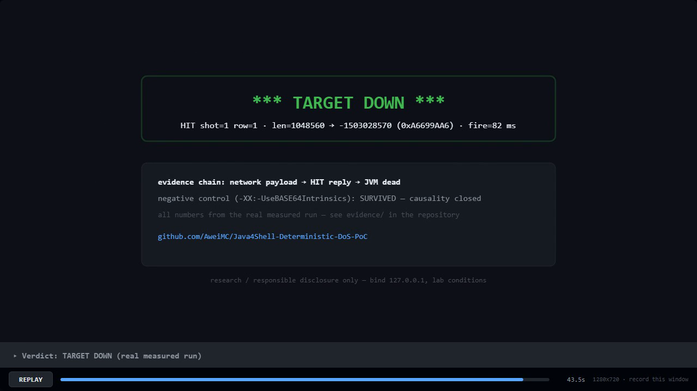

# Java4Shell-Deterministic-DoS-PoC

  

**CVE-2026-114938（Java4Shell）衍生 PoC：两次连续单参 `decode(byte[])` + humongous 洞几何实现确定性拒绝服务。纯 JDK Client → Server。**

[English](README.md) | [简体中文](README_zh-CN.md) · 完整分析：[REPORT_zh-CN.md](REPORT_zh-CN.md) | [REPORT.md](REPORT.md)

---

## 这是什么

CVE-2026-114938 的官方参考 PoC（[Pwned-test/cve-2026-114938-java17-PoC](https://github.com/Pwned-test/cve-2026-114938-java17-PoC)）需要借助**双参** `decode(byte[], byte[])` 重载 + 超大目标数组才能观察到越界写——本项目的层一探测器沿用了这一技术（外加 8KB 有界缓冲带）。攻击本身则去掉了双参前提：

- **唯一的射击 API 是单参 `decode(byte[])`** —— 真实应用最普遍的解码入口（HTTP Basic 头、token、上传字段）—— **连续执行两次**（射击 → 重装填 C2 → 再射击）。
- 触发长度（`2,796,161 = 64k+1`）经过定制，使解码器内部目标缓冲区成为 **region 对齐的 humongous 对象**，恰好填进 G1 eager-reclaim 留下的洞。intrinsic 的 64 字节定值写于是**确定性**跨界 32 字节，打中洞后哨兵数组的对象头。
- length 字段被污染后转为主动越界读 → **SIGSEGV + hs_err 取证**。没有堆布局抽奖：**实测 5/5 全部在 ≤2 发内命中**（3 次干净布局 + 2 次发布版复核，全部存档于 `evidence/`；单发耗时 82–584 ms）。
- 负对照闭环因果：`-XX:-UseBASE64Intrinsics` → 零溢出、受害端存活。
- **GC 适用范围**：越界写本身与 GC 无关，但确定性几何**仅限 G1**（humongous
  region 对齐 + eager-reclaim 成洞）。Serial/Parallel GC 下本配方退化为概率性。

## 演示

[](assets/demo-mechanism.mp4)

▶ **46 秒机制动画**（[assets/demo-mechanism.mp4](assets/demo-mechanism.mp4)）：成洞 → 触发串投递 → humongous dst 填洞 → 64B 定值写跨 region 边界 32B → 哨兵 length 被污染（`0xA6699AA6`）→ SIGSEGV + hs_err → 判决。所有数字均来自 `evidence/` 中的真实实测。交互版：[docs/attack-visualization.html](docs/attack-visualization.html)（浏览器打开，空格 = 暂停）。

## 环境要求

| 条件 | 说明 |
|---|---|
| x86-64 CPU 且支持 AVX-512 VBMI | Intel Ice Lake+ / AMD Zen 4+（`avx512f`、`avx512bw`、`avx512vbmi`、`bmi2`） |
| 未修复运行时 | Java 17 线 **≤ 17.0.21**（区间下限据公告声称；17.0.21+9 经独立矩阵实测仍可复现——plain 17.0.21 不存在"已修复"状态），或修复前的 Java 21/25 构建。修复版：17.0.21.1 / 21.0.13.1 / 25.0.5.1 |
| G1 GC | `-XX:G1HeapRegionSize=1m`（启动脚本已带） |
| 实测环境 | Windows x86-64，Zulu JDK 17.0.20+8 |

## 快速开始

Linux / macOS：

```bash
./build.sh
./run-server.sh          # 终端 A —— 受害服务端，绑定 127.0.0.1:47470
./run-client.sh          # 终端 B —— 攻击客户端
```

Windows：

```bat
build.bat
run-server.bat           :: 窗口 A —— 受害服务端
run-client.bat           :: 窗口 B —— 攻击客户端
```

预期客户端输出：`HIT shot=N ... → TARGET DOWN (verified: port closed)`，退出码 `0`。
预期服务端输出：`*** LENGTH CORRUPTED *** ... 0xA6699AA6`，随后 `EXCEPTION_ACCESS_VIOLATION`，`logs/` 下生成 `hs_err_pid*.log`。

单机环境自检（无需网络）：

```bash
java -cp out com.aweimc.j4shell.Main probe --len 129
# 预期：spill=[98..160) oob=62B  REPRODUCED
```

负对照（应存活）：

```bash
./run-server-safe.sh     # = -XX:-UseBASE64Intrinsics；客户端应报 SURVIVED（退出码 2）
```

## 实测结果（本机，Zulu 17.0.20+8）

| 轮次 | 裁决 | 细节 |
|---|---|---|
| run2（首个干净布局） | **TARGET DOWN** | `HIT shot=2 row=2 len=1048560→-1503028570 (0xA6699AA6)`，fire 584 ms |
| run3 | **TARGET DOWN** | `HIT shot=1 row=1 ... (0xA6699AA6)`，fire 219 ms |
| run4 | **TARGET DOWN** | `HIT shot=1 row=1 ... (0xA6699AA6)`，fire 138 ms |
| 发布版 E2E（sh 脚本） | **TARGET DOWN** | `HIT shot=1 row=1 ... (0xA6699AA6)`，fire 82 ms |
| 发布版 E2E（bat 脚本） | **TARGET DOWN** | `HIT shot=1 row=1 ... (0xA6699AA6)`，fire 102 ms（存档：`evidence/e2e-bat-client-output.txt`） |
| 负对照 | 存活 | `probe=none`、`SURVIVED shots=2`，客户端退出码 2 |
| 修复版对照（Zulu 17.0.21.1） | 存活 | probe `oob=0`，E2E `SURVIVED` —— 见报告 §6.4 |

**正向 5/5 在 ≤2 发内命中；负对照与修复版对照均存活。**

证据文件在 [`evidence/`](evidence/)：probe 输出、客户端/服务端控制台实录、`hs_err_victim-SIGSEGV.log`（`Problematic frame: j com.aweimc.j4shell.DualDecodeVictim.forceCrash(II)V+68`）、负对照实录。

## 仓库结构

```
src/com/aweimc/j4shell/   Payload / DualDecodeVictim / J4ShellServer / J4ShellClient / Main
build.sh / build.bat      编译（纯 JDK，无第三方依赖）
run-server.sh|.bat        受害服务端（127.0.0.1:47470）
run-server-safe.sh|.bat   负对照（-XX:-UseBASE64Intrinsics）
run-client.sh|.bat        攻击客户端
evidence/                 probe + E2E 实录 + hs_err 取证 + 负对照
REPORT_zh-CN.md           完整技术报告（中文）/ REPORT.md（English）
```

## 适用面与局限（务必阅读）

- 确定性命中依赖 **humongous 洞布局**，本 PoC 由受害端在 `arm()` 阶段主动构造。对未做布局条件化的真实应用：humongous dst 每次分配仍然 region 对齐、越界写仍然结构性跨界 32B，但跨界后**打中谁**是概率性的——本配方把命中从"10 万周期抽奖"升级为"每发确定性跨过 32B 高价值边界"。未条件化应用的多发改决率量化留待后续工作。
- 真实 Minecraft 服务端/客户端**不可达**（线协议无解码面，前期工作已实测）——本受害端是专为实验构建的本地服务。
- 仅用于**本地/授权环境**的漏洞研究。服务端默认只绑定 `127.0.0.1`。不得用于你不存在所有权或书面授权的系统。

## 缓解

升级到 17.0.21.1+ / 21.0.13.1+ / 25.0.5.1+（修复版本号带 `.1` 后缀）。临时缓解：`-XX:-UseBASE64Intrinsics`（跨架构）或 `-XX:UseAVX=2`（仅 x86-64）。

## 许可 / 署名

本项目以 [MIT License](LICENSE) 发布。研究代码 by [AweiMC](https://github.com/AweiMC)。漏洞由 Calif 于 2026-11-17 披露（"Java4Shell" / CVE-2026-114938）。
